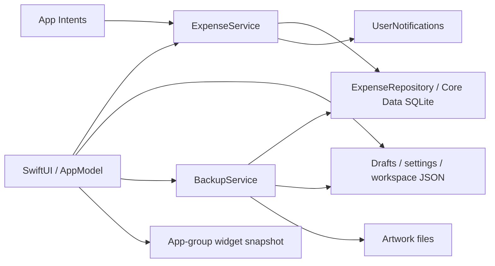

# Backend audit — 2026-10-04

Monocle has a useful local persistence foundation, but several normal workflows can break durable references, lose drafts, or disable recovery. Fix those integrity failures before moving persistence work off the main actor or tuning queries. The implementation sequence is in [the backend improvement plan](../planning/backend-improvement-plan.md).

This branch contains the audit and plan only. No application fixes, data migrations, release builds, or IPA publications were performed.

## Baseline and verification limits

- Branch: `audit/backend-2026-10-04`, in a separate worktree at `/workspace/monocle-backend-audit`.
- Reviewed commit: `b7621cc0e2133336a4f4faa9961447dbde6a9b16`; remote `main` matched it when work began.
- Release in source: 0.7.20, build 83; iOS 26 minimum, Swift 6.
- Scope: all persistence/application/domain services, startup and lifecycle, Core Data V1–V3, backups and artwork, CSV, recurring bills, notifications, App Intents, widget snapshots, spending sessions, app lock, and their feature callers/tests. Presentation styling and release infrastructure were reviewed only where they affect these paths.
- “Backend” here means the local data and integration layer. There is no HTTP server, remote database, implemented CloudKit synchronization, or third-party runtime package in this repository. Server capacity, production telemetry, and cloud access controls therefore cannot be assessed from it.
- Review used source tracing, schema/configuration inspection, test inspection, and independent arithmetic/structural checks on Linux. Neither Swift nor Xcode is installed. **The app was not compiled or executed; XCTest, Instruments, notification delivery, authentication, and device latency were not verified in this audit.**
- Findings marked confirmed describe a reachable source path or counterexample. Conditional findings identify their required failure/input explicitly. They are not claims of observed incidents on the user's device.

The September audit's fixes for full-workspace backup selection, ordinary card switching, clear-all bill suppression, and cross-card expense validation remain present. Its reported 118 unit-test passes are historical evidence, not a test result from this session.

## Architecture and existing protections



Strengths worth preserving:

- Financial records use `Int64` minor units. Individual expense validation checks positive totals, allocation references, unique split categories, and checked allocation sums.
- Managed objects stay in the repository; consumers receive value types. Synchronous main-actor commands currently serialize writes within one process.
- Repository transactions batch expense/occurrence writes and roll back failures. A single-expense save publishes after commit without a fallible follow-up fetch.
- Service reload stages a complete snapshot before publication. Ordinary draft/card switching validates and loads the target before changing presentation state.
- Local JSON writes use atomic file replacement. Backup restoration retains a rollback journal; startup attempts journal recovery before normal initialization.
- Core Data is versioned from V1; relationship inverses are present in all three versions. No migration failure was established by this review.
- CSV has a review stage, backup validation already rejects several cross-card references and aggregate overflow, and existing tests cover many daily ledger operations.

The main architectural weakness is coordination: a user command may affect SQLite, several JSON files, assets, observable caches, and OS integrations, while each has a different commit/publication path.

## Priority index

P1 means a high-impact integrity, recovery, or privacy failure to address first. P2 means incorrect behavior, a conditional crash, or a demonstrated scalability bottleneck that follows the integrity work. Severity is separate from likelihood; the extreme-money and corrupted-record examples are explicitly conditional.

| ID | Priority | Finding | Evidence type |
| --- | --- | --- | --- |
| F01 | P1 | Removing a budget-only category leaves invalid budget history | Confirmed |
| F02 | P1 | Expense deletion/sample promotion breaks recorded-bill links | Confirmed |
| F03 | P1 | Successful real-card save clears the wrong durable draft | Confirmed |
| F04 | P1 | Destructive retries can overwrite an unresolved recovery journal | Confirmed, requires rollback failure |
| F05 | P1 | Valid live data can outgrow every backup/recovery operation | Confirmed |
| F06 | P1 | Workspace preview accepts incomplete financial/preference invariants | Confirmed, crafted input |
| F07 | P1 | Global category migration uses unscoped IDs and a premature completion marker | Confirmed, legacy/imported data |
| F08 | P1 | Malformed workspace preferences are silently replaced at startup | Confirmed, malformed file |
| F09 | P1 | Recurrence edits can add unintended historical and obsolete charges | Confirmed |
| F10 | P1 | Restored lock settings do not update the running lock controller | Confirmed |
| F11 | P2 | Live totals/projections can overflow despite valid individual amounts | Confirmed, boundary amounts |
| F12 | P2 | Accepted fractional amounts lose precision during edits/CSV export | Confirmed |
| F13 | P2 | Commands can report failure after committing successfully | Confirmed, follow-up read failure |
| F14 | P2 | Compound workspace/category changes are only partially atomic | Confirmed, mid-operation failure |
| F15 | P2 | Damaged bill/occurrence rows are defaulted or silently ignored | Confirmed, malformed persisted data |
| F16 | P2 | Malformed CSV quotes silently merge transactions | Confirmed |
| F17 | P2 | Reminder permission and complete scheduling reconciliation are missing | Confirmed source gaps; delivery untested |
| F18 | P2 | Automatic bill reconciliation covers only the active card | Confirmed |
| F19 | P2 | Shortcut commits bypass cache and widget publication | Confirmed; process-lifecycle dependent |
| F20 | P2 | Reports mix scoped expenses with active-card budgets/categories | Confirmed |
| F21 | P2 | Persisted dates depend on the user's current calendar | Confirmed; calendar-change dependent |
| F22 | P2 | Resuming an edit draft after time-zone travel can change its day | Confirmed |
| F23 | P2 | Restore retains stale permanent-hidden-card state | Confirmed |
| F24 | P2 | Fresh reset retains category rules/archive IDs for deleted data | Confirmed |
| F25 | P2 | Live Activity replacement races and its support flag is absent | Confirmed source defects; device behavior untested |
| F26 | P2 | Imports, snapshots, and repeated reports do unbounded main-actor work | Confirmed work placement/complexity; unmeasured latency |
| F27 | P2 | Artwork is neither fully validated in preview nor guaranteed in snapshots | Confirmed, invalid/missing asset |

## Detailed findings

### F01 — Removing a budget-only category leaves invalid budget history

**Evidence:** `Monocle/Persistence/ExpenseRepository.swift:436–443,488–497`; `Monocle/Domain/Expense.swift:345–349`; `Monocle/App/AppEnvironment.swift:19–20`.

Create a category budget without an expense or bill using that category, then deactivate or delete it. Both repository paths check expense/bill dependencies but omit historical budget limits. Core Data stores the budget's category UUID as a scalar, so category deletion commits successfully. Later budget reads reject the missing reference; an affected default/active card can prevent startup from opening the workspace.

**Fix and acceptance:** Keep referenced historical categories when deactivating; reject hard deletion or apply an explicit, atomic history migration. Test budget-only references through per-card/global deletion, reload, SQLite reopen, and full export. Include all budget versions, not just the current period.

### F02 — Expense deletion and sample promotion break recorded-bill links

**Evidence:** `ExpenseRepository.swift:550–558,753–756`; `Monocle/Domain/BookBackup.swift:425–432`; `Monocle/App/AppModel.swift:922–933`.

Delete an expense created by a confirmed or automatic bill. The occurrence remains recorded with an `expenseID` whose expense has been removed. Workspace backup validation then fails, including the safety snapshot required by clear/reset/restore. Sample-to-real promotion also deletes expenses while retaining bill occurrences. `clearExpenses` already repairs links; these paths do not.

**Fix and acceptance:** Apply one deletion command that updates every linked occurrence atomically and suppresses automatic recreation. Define undo semantics for restoring the original linkage. Verify confirmed/automatic bill deletion, reconciliation, undo, reopen, backup, and sample promotion with recorded bills.

### F03 — Successful real-card save clears the wrong durable draft

**Evidence:** `AppModel.swift:399–405,890–898`; `Monocle/Persistence/LocalStateStore.swift:78–99`.

After saving an expense, the model replaces its draft with `ExpenseDraft()` without a book ID. Unscoped persistence maps that draft to the sample card, erasing any sample-card draft and leaving the real card's saved input on disk. If the process ends before switching away, reopening that card restores stale input and the original expense ID. A later save can overwrite the recorded expense or resurrect a deleted one. An immediate card switch often heals the real-card slot, but cannot recover the erased sample draft.

**Fix and acceptance:** Clear the saved owner's draft explicitly and retain that owner in memory. Treat a committed expense with failed draft cleanup as a distinct outcome. Use the real file store to test two independent drafts, save, immediate disk inspection, termination/reopen, and cleanup failure. The current fake aliases scoped/unscoped saves and misses this difference.

### F04 — Destructive retries can overwrite an unresolved recovery journal

**Evidence:** `Monocle/Application/BackupService.swift:60–80,86–105,111–132,138–177`; `AppModel.swift:792–826`; contrast guarded restore at `BackupService.swift:219,254`.

Clear/reset/start/rename write new safety and journal files without rejecting an existing journal or blocked recovery state. If the original operation and rollback both fail, the service becomes blocked but these model callers leave the normal reset UI visible. After storage becomes writable, a retry whose current snapshot is valid can overwrite both recovery artifacts with partially changed state before the blocked reload fails again.

**Fix and acceptance:** Centralize admission for every destructive command; preserve existing journal/safety bytes while recovery is pending and expose the recovery screen for every caller. Inject operation failure plus rollback failure, then retry each command. Assert no mutation, byte-identical recovery artifacts, and restart recovery to the original workspace.

### F05 — Valid live data can outgrow every backup/recovery operation

**Evidence:** `BookBackup.swift:385,395–396,438–443`; `BackupService.swift:32–57,112,139,220,255`; `Monocle/Application/ExpenseService.swift:326–338`.

Live writes permit a card to grow beyond 10,000 expenses and allow more than 100 cards, while workspace validation rejects those sizes. JSON plus base64 artwork must also fit 10 MiB. Every destructive command first encodes the original workspace, so exceeding these limits blocks export, restore, clear, and reset, including attempts to reduce the data. Multiple allowed imports can reach this state.

**Fix and acceptance:** Separate external-input limits from lossless internal backup/recovery capacity. Choose a scalable, versioned manifest/asset format or equivalent bounded implementation. Test 10,001+ expenses, 101 cards, and data/artwork above 10 MiB. Complete export, restart, restore, and rollback must remain possible without truncation or omission of safety backups.

### F06 — Workspace preview accepts incomplete graph invariants

**Evidence:** `BookBackup.swift:383–436`, compared with legacy validation at `123–150`; `BackupService.swift:210–214`; `ExpenseRepository.swift:674–739`; `Monocle/Domain/CardCustomization.swift:147,202`.

Formats 4–6 omit budget ID/effective-day uniqueness, settings limits/start-day checks, rule/archive references, global-category validation, and preference graph checks. Occurrences need only a unique UUID and optional existing expense reference: two pending occurrences for one rule/day, or a recorded occurrence without an expense, pass validation. Reconciliation can record both pending entries or suppress an unrecorded charge. Duplicate budget effective days pass preview but fail later repository reads, causing activation/rollback work after the preview claimed the candidate was acceptable.

Preview creates an in-memory store but never compares a full canonical readback. An invalid palette index such as `Int.min` can also reach `abs(index)` in card rendering because preference ranges are unchecked.

**Fix and acceptance:** Share complete graph validation across commands, files, and preview; compare canonical records/settings/preferences/assets after materialization. Reject the counterexamples before touching active data or recovery files. Preserve formats 4/5/6 through explicit normalization: existing fixtures intentionally permit sample-profile settings alongside real workspace books, so tightening that relationship needs a migration policy.

### F07 — Global category migration is unscoped and can mark completion too soon

**Evidence:** `ExpenseRepository.swift:505–539`; `AppModel.swift:300–329`.

Migration maps old category UUIDs to canonical UUIDs in a single dictionary across all books. Legacy/imported cards can reuse an old UUID with different names; the last mapping wins for every budget/bill scalar reference, even in another book. Allocation relationships retain the correct row, while budgets and bills can receive the wrong or missing category. Per-card drafts and local rule/archive/inactive references are not migrated with the database.

The caller persists a nonempty global catalog before attempting the migration using `try?`. A failure or interruption can therefore leave a catalog that prevents migration from being attempted on the next launch.

**Fix and acceptance:** Scope mappings by `(bookID, oldCategoryID)`, migrate all dependent state through a recoverable command, and write completion only after validation succeeds. Test differently named categories sharing an old UUID, inactive-card drafts, rules, budgets, bills, interruption, retry, and reopen.

### F08 — Malformed workspace preferences are silently replaced at startup

**Evidence:** `AppModel.swift:259–273,283–329,677–682`; `LocalStateStore.swift:105–115`.

A malformed `workspace.json` throws in the file store, but model initialization suppresses the error with `try?`. Default-stack/catalog initialization then saves default preferences over the damaged file. This loses recoverable stack/category/appearance/artwork references and may trigger unintended catalog migration. Draft/settings corruption is handled more carefully at the composition root; workspace corruption is not.

**Fix and acceptance:** Load and validate workspace state at startup with the same fail-preserve behavior as settings/drafts. Distinguish a missing file from a malformed file. Test invalid JSON and invalid semantic references; startup must preserve the original bytes and avoid database or preference initialization until a recovery policy is chosen.

### F09 — Recurrence edits can create unintended historical and obsolete charges

**Evidence:** `Monocle/Domain/BillReconciliationEngine.swift:103–127`; `ExpenseService.swift:174–194`.

Change a previously used automatic monthly bill from the 15th to the 20th. Reconciliation generates the new schedule starting from the rule's original creation date, adding previously nonexistent historical 20ths alongside recorded 15ths. Existing lookahead occurrences for the old 15th remain and can still be promoted automatically because promotion does not test membership in the current schedule.

**Fix and acceptance:** Introduce explicit schedule revisions/effective dates. Preserve recorded/skipped history, and remove or supersede obsolete pending future occurrences atomically. Test day/weekday/frequency changes after several recorded cycles and across lookahead; assert no historical additions or old-schedule charges unless explicitly requested.

### F10 — Restored lock settings do not update the running lock controller

**Evidence:** `AppModel.swift:1148–1177`; `Monocle/Application/AppLock.swift:52–69,105–110`.

Restore a backup with app lock enabled into a running unlocked app. Settings reflect the imported timeout, but the existing controller retains `timeout == nil`; background/foreground transitions do not require authentication until process restart. Restoring disabled lock settings produces the reverse mismatch. Reload does not synchronize the controller either.

**Fix and acceptance:** Define restoration's lock policy and publish settings/controller state together. Enabling the restored lock must require authentication before revealing financial content; the existing helper that clears `needsAuthentication` is insufficient alone. Test enabled/disabled/changed-timeout restore, foreground suspension, authentication failure, and cold restart. Fresh reset currently preserves the timeout and is not this mismatch.

### F11 — Valid individual amounts do not make totals and projections safe

**Evidence:** `AppModel.swift:256,353,735`; `Monocle/Domain/AnalyticsEngine.swift:392,453,498–516`; `Monocle/Domain/CSVEngine.swift:505–523`; `Monocle/Integrations/Widgets/WidgetSnapshotUpdater.swift:17,41,54`.

Most live aggregates use unchecked `Int64` addition; projections use unchecked multiplication. The permitted per-expense maximum is `9_000_000_000_000_000` minor units. **1,025** individually permitted maximum entries exceed `Int64.max`; 1,024 fit. A CSV preview can reach that boundary within its file/row limits. Projection can overflow even with a representable ledger total: 34 maximum entries on the first day of a 31-day period yield an unrepresentable projected total. These are extreme inputs, not ordinary spending, but are currently accepted boundaries.

**Fix and acceptance:** Define a shared exact aggregate/overflow policy for UI, CSV, widgets, budgets, and analytics. Use checked operations or a wider exact representation and return a useful error/overflow state. Do not silently clamp financial totals. Test both addition boundaries, projection multiplication, tiny budgets/large pace percentages, and import rejection without mutations.

### F12 — Accepted fractional minor units lose precision in edits and CSV

**Evidence:** `Monocle/Domain/Expense.swift:84–99,143,207–210`; `CSVEngine.swift:203,211`.

The persisted validator accepts a total of 150 minor units, and backups preserve it. Draft creation converts it using integer division by 100; editing only the note and saving converts it to 100. CSV export likewise truncates total/allocation values. Whole-rupiah manual entry is intentional, but the persistence/import contract does not enforce that policy. Existing stress fixtures also create nonmultiples of 100.

**Fix and acceptance:** Choose one explicit precision contract. Either preserve every accepted historical amount through edits/export, or reject future fractional inputs while providing a lossless migration/read path for existing records. Test 150 minor units through backup, note-only edit, split edit, CSV, and reopen; never silently round old data.

### F13 — Some commands throw after a successful durable commit

**Evidence:** `ExpenseService.swift:111–115,174–194,278–285,326–338`.

Book creation, batch imports, and bill operations commit first, then call a fallible reload. A follow-up read error reaches the caller as if the whole operation failed. Retrying book creation generates another UUID/book; import retry behavior depends on whether IDs were retained or regenerated. The existing single-expense command already avoids this problem.

**Fix and acceptance:** Return a committed result/identity separately from refresh status, or stage the complete resulting snapshot inside the transaction before commit. Inject post-commit read failures for every command family; verify durable result, retry identity, and a clear stale-snapshot state without duplicate records.

### F14 — Compound workspace/category changes can leave partial state

**Evidence:** `AppModel.swift:477–523,677–682,984–996,1023–1091,1184–1214`; `Monocle/Features/CardCustomizerView.swift:259–290`.

Global category saves write catalog JSON before updating database metadata and card activation one card at a time. Activation changes memory before a fallible database write, while preference persistence catches errors instead of propagating them. Card creation/customization similarly combines several independently committed steps with best-effort writes. Budget save commits the version before writing duplicated settings and reports an error after adopting those settings in memory.

**Fix and acceptance:** Introduce explicit workspace commands with proposed-state validation, database transaction boundaries, and a recoverable protocol for the remaining files. Prefer one authoritative home for financial configuration. Publish memory/toasts only from the command result; surface best-effort integration errors separately. Inject failures at every step and verify either complete old state or complete new state across restart.

### F15 — Bill persistence silently tolerates damaged financial state

**Evidence:** `ExpenseRepository.swift:181–207,219–227,305–320`.

Unknown recurrence text defaults to monthly, returned bill rules are not validated, and unreadable occurrences are skipped. An ignored occurrence makes its due day appear absent to reconciliation, which can generate another automatic expense even though the original expense remains. Occurrence writes lack shared date/status/link validation. This finding requires malformed stored data or an inconsistent internal caller; no ordinary multi-process corruption incident was observed.

**Fix and acceptance:** Validate rules and occurrences on read/write and fail closed with preserved data. Enforce one occurrence per rule/day and consistent same-book expense links. Insert malformed rows directly in persistence fixtures and assert reopen/reconcile reports corruption without generating new spending. Keep recovery/export of damaged evidence separate from automatic repair.

### F16 — Malformed CSV quotes silently merge transactions

**Evidence:** `CSVEngine.swift:105–159`; `Monocle/Features/CSVInterchangeView.swift:517–530`.

The tokenizer never rejects EOF inside a quoted field or invalid quote transitions. In this input, the second transaction becomes part of the first note and only Rp1,000 is offered for import:

```csv
Date,Amount,Note
2026-10-01,1000,"Lunch
2026-10-02,2000,Dinner
```

**Fix and acceptance:** Use an error-returning tokenizer with strict quote transitions and logical record locations. Apply field/row limits while parsing, not after full materialization. Reject malformed input without any writes; preserve valid multiline fields and escaped quotes.

### F17 — Reminder authorization and full scheduling reconciliation are missing

**Evidence:** `Monocle/Integrations/BillNotificationService.swift:16–20,46–76`; `ExpenseService.swift:188–193,223–230`; repository-wide search found no caller of its authorization wrapper.

Fresh installs have no implemented reminder-permission request, although reminders can be enabled. Notification errors are discarded. Reconciliation schedules only newly changed occurrences, so restored/existing pending occurrences are not rebuilt in the OS schedule. Card deletion, reset, and replacement restore also omit cancellation of old workspace requests. With permission already granted, deleted-data reminders can survive and restored reminders can be absent.

**Fix and acceptance:** Request permission at an explicit reminder action, expose authorization state, and derive the desired OS schedule from all active persisted rules/occurrences. Diff/cancel/rebuild after restore, reset, deletion, launch, and edits; handle the system request limit. Test through an injected notification client, then prove delivery/denial/restore on a signed device.

### F18 — Automatic bill reconciliation covers only the active card

**Evidence:** `AppModel.swift:272,333–336`; `ExpenseService.swift:103–108,206–210`.

Startup/foreground reload reconcile only the default active card. Selecting another card reloads its data but does not reconcile its bills. Daily use on card A can leave automatic charges on card B absent or pending; even selecting B and opening Bills does not reconcile until a later reload/lifecycle transition with B active.

**Fix and acceptance:** Reconcile eligible books through a bounded workspace command, independent of UI selection. Preserve occurrence idempotency and commit/report outcomes per the chosen command contract. Test due automatic bills on two cards while only one is selected, repeated launches, and reopen with no duplicate charges. Background execution remains opportunistic; do not promise exact unattended execution.

### F19 — Shortcut commits bypass cache and widget publication

**Evidence:** `Monocle/Integrations/ExpenseIntents.swift:301,344`; `ExpenseService.swift:311–324`; `AppModel.swift:685–737,756–773`.

Intents commit directly through the service; cache invalidation and widget snapshot refresh live in model commands. A warmed inactive-card or all-activities cache can omit a Shortcut expense in the same app process. Widget files have no post-intent refresh path. A foreground reload may heal stale state, so persistence loss is not claimed.

There is also no trustworthy missing/stale snapshot state: `WidgetSnapshotStore.swift:17–23` substitutes `.sample` for unreadable/missing data, and `WidgetSnapshot.swift:28–78` contains invented spending and transactions. Production timeline providers use that loader. They reread precomputed totals rather than rebuilding them at midnight, so “Today” can also describe the previous day's snapshot until the app publishes again. The fallback to each process's caches directory when App Group access fails is not shared storage and hides the access failure.

**Fix and acceptance:** Give all command consumers a shared committed revision/event/snapshot path and refresh projections from that revision. Use an explicit unavailable/stale state in production; reserve sample values for gallery placeholders. Include the reporting day/revision in freshness validation and make App Group write/access failure visible to diagnostics. Test manual/text/structured/batch/bill mutations with warmed caches, inactive cards, no navigation, missing/corrupt snapshots, and midnight rollover. Validate actual Shortcuts execution and widget data on the signed device.

### F20 — Scoped reports use another card's financial configuration

**Evidence:** `Monocle/Features/AnalyticsView.swift:179–242,340–344`; `Monocle/Features/CardBackTelemetryView.swift:18–23,42–72`.

Analytics' card picker changes local scope, not the service's active card. Expenses come from card B, but cycle, budget limits, and categories still come from active card A. Stack reporting likewise uses one card's budget without a defined aggregate budget policy. Card-back telemetry can mix its displayed card's expenses with active-card budgets/bills. Different start days, limits, or category sets produce incorrect financial reporting.

**Fix and acceptance:** Build a scoped reporting snapshot containing expenses, categories, budget history, bills, calendar, and revision. Define stack/all-card cycle and budget semantics explicitly. Test two cards with different start days/limits/categories while A stays active and B is selected solely in analytics/telemetry.

### F21 — Persisted dates depend on the user's current calendar

**Evidence:** `Expense.swift:151–161,288–303,375–388`; `CSVEngine.swift:319–325`; `BillReconciliationEngine.swift:98–106`.

`YYYY-MM-DD` serialization and interpretation use `Calendar.current`. A Buddhist or other calendar can serialize a different year for the same date; changing system calendar later reinterprets existing strings under the new calendar. Records can appear in the wrong century/period or fail validity checks. Display localization must be separate from the durable reporting-date contract.

**Fix and acceptance:** Persist a defined Gregorian civil date with an explicit reporting time-zone policy; localize only presentation. Existing non-Gregorian strings cannot safely be guessed, so determine migration using historical metadata/fixtures and preserve uncertain records. Test Gregorian/Buddhist/Islamic calendar changes, Jakarta/UTC time zones, DST, leap years, CSV, recurrence, and backup round-trips.

### F22 — Resuming an edit draft after time-zone travel can change its day

**Evidence:** `Expense.swift:156–160,183,203,207–210,222,233`.

The persisted expense has a civil-day string, but its edit draft stores an absolute `Date` constructed from noon in the current time zone. Saving converts that instant back to a day using the new current time zone. Edit a Jakarta expense, persist the unfinished draft, then resume it in Los Angeles: Jakarta noon falls on the previous evening there. A note-only save can change the recorded reporting day. New unfinished drafts have the same instant-to-day ambiguity.

**Fix and acceptance:** Persist the intended reporting civil day separately from the DatePicker's date adapter and audit timestamps. Define backward decoding/migration for existing drafts. Test new/edit drafts across Jakarta/Los Angeles and UTC±14, restore/relaunch, and note-only saves that preserve the original day. Separately normalize transition range boundaries to start of day and test inclusive-start/exclusive-end behavior; no current transition-total discrepancy was established in this audit.

### F23 — Restore retains stale permanently hidden cards

**Evidence:** `AppModel.swift:1161–1177,677–681`; compare initialization at `265–268`.

Workspace restore sets preferences and ordinary hidden IDs but leaves `alwaysHiddenBookIDs` unchanged. Restored visibility is wrong immediately, and the next preference write replaces imported permanent-hidden settings with that stale set.

**Fix and acceptance:** Publish all derived workspace state from one restored snapshot. Restore opposite hidden settings for identical card IDs; verify immediately, after another preference edit, and after restart.

### F24 — Fresh reset retains stale category configuration

**Evidence:** `BackupService.swift:149–165`; `AppModel.swift:813–825,1018–1020`; `Monocle/Features/ResetDataView.swift:105–107`.

Reset copies old settings and changes only the book. Archived default category IDs hide newly reseeded defaults; rules pointing to deleted custom categories survive. The service's configured rules/archive set is not explicitly refreshed. A clean category count in the current reset test does not establish usable categories.

**Fix and acceptance:** Specify retained nonfinancial preferences, clear deleted-data references, and synchronize service settings/budget state. Test archived defaults plus custom category rules, reset, text capture, backup, and restart.

### F25 — Live Activity replacement races; support configuration is absent

**Evidence:** `Monocle/Integrations/Widgets/SpendingSessionManager.swift:39–42,98–116`; `Monocle/Resources/Info.plist`, `project.yml`, and committed Xcode settings omit `NSSupportsLiveActivities`.

Starting session B while A is active queues `endSession`, replaces `currentActivity`, and later runs a task that dereferences the mutable property. It can end B and clear its reference while orphaning A. A queued expense update can similarly target a replacement session. The app support flag is also missing; in-memory session tests cannot prove that system activities work.

**Fix and acceptance:** Capture immutable activity/session identities in asynchronous work and prevent an old generation from clearing a new session. Add the platform support configuration in both generated and committed project inputs. Test start A → update → start B → delayed completion, end/restart, ActivityKit denial, and actual lock-screen/Dynamic Island behavior. Define whether sessions recover after process termination before presenting durable session totals.

### F26 — Backend work and repeated reporting monopolize the main actor

**Evidence:** `ExpenseRepository.swift:4,118–136,351–372,775–808`; `ExpenseService.swift:64,326–338`; `AppModel.swift:677–735`; `CSVInterchangeView.swift:501–566`; `AnalyticsEngine.swift:282–390`.

Imports perform validation/upserts, category lookups, and complete reloads synchronously. Backup parsing/materialization, JSON/asset I/O, recurrence catch-up, and CSV parsing also run through main-actor callers. Expense reads realize an entire relationship graph and sort it; there are no date-range/paged repository APIs or explicit fetch indexes. Preference-only changes invalidate all expense caches and rebuild widget aggregates. Several analytics computed properties independently regroup/recompute the same data; `AnalyticsView.swift:652–658` reads the computed `metrics` inside each daily chart row, rebuilding daily/category points repeatedly. Card telemetry and per-category budget labels repeat related calculations. The month-over-month engine itself already groups expenses in one pass.

These are demonstrated work-placement/query-shape problems, **not measured latency or memory numbers**. The existing 750-write stress test verifies correctness, not responsiveness at 10,000 records.

**Fix and acceptance:** Establish profiling baselines first, then move heavy operations to serialized background persistence/value computation with bounded pages, cancellation, and one publication. Reuse one scoped analytic snapshot; invalidate on committed data revisions, not appearance edits. Add indexes only from measured predicates/query plans and migration tests. Use the fixture sizes and proposed budgets in the implementation plan.

### F27 — Artwork validation/completeness is deferred until activation

**Evidence:** `BackupService.swift:47–51,210–214`; `BookBackup.swift:388–390`; `ExpenseRepository.swift:739–742`; `Monocle/Persistence/CardArtworkStore.swift:25–27,57–65`.

Snapshot silently skips missing/unreadable referenced artwork. Validation checks asset dictionary filenames, but not every customization filename/reference, required asset presence, image decoding, or pixel limits. Preview disables artwork import; activation imports/decode-checks after the database commit, creating avoidable rollback work. Imported images bypass the normal 1,200-pixel downsampling path, so byte-size admission alone does not bound decoded memory.

**Fix and acceptance:** Inject an artwork store, validate references/bytes/dimensions before activation, and stage assets within the recovery protocol. Report missing assets explicitly rather than claiming a complete backup. Test missing/corrupt/oversized images, arbitrary customization filenames, write failure after partial asset import, rollback, restart, and large-image memory on device.

## Coverage, operational controls, and remaining risks

| Area | Reviewed/current evidence | Required follow-up |
| --- | --- | --- |
| Financial commands | Positive exact minor-unit amounts; checked allocation totals; transaction rollback; 118 unit test methods in source | Counterexamples F01–F15, consistent precision/aggregate policy, post-commit outcomes |
| Persistence concurrency | Main-actor synchronous command serialization; no current second database writer established | Preserve serialization when moving work; define nested rollback behavior; occurrence identity validation |
| Model migration | V1 migration fixture; additive V1–V3 schemas; all inverses resolve | On-disk V2→V3/current fixtures, populated multi-card/budget/bill graphs, failure preservation, migration timing |
| Backup/recovery | Legacy stage fault tests, workspace round-trips, safety snapshots | Workspace/asset stage interruption matrix, capacity growth, immutable journal admission, complete readback |
| Import/export | Review-before-save; duplicate hints; existing CSV tests | Malformed quotes, logical-row limits, precision policy; CSV currently flattens splits into a display string and does not recreate split allocations on import—document this limitation |
| Notifications | Per-occurrence replacement/cancellation serialization | Permission flow, full desired-state diff, system request cap, signed-phone delivery |
| Intents/widgets | Shared command service; authenticated intents; atomic snapshot file | Revision-based publication, signed entitlement/group access, stale and failed snapshot diagnostics |
| App lock/privacy | Device-owner authentication, privacy shield, configurable grace period | Restore synchronization; decide and document widget/reminder information visible while app is locked; verify OS file protection on SQLite/WAL/JSON/app-group assets |
| Observability | User errors in some paths; many best-effort errors ignored; no backend signposts | Structured OSLog categories, error/result distinctions, durations/counts/revisions, redaction of notes and amounts, recovery state diagnostics |
| Automated validation | 118 unit and 42 UI test methods; `scripts/test.sh`; no `.github/workflows` files | macOS build/unit validation on every backend change; focused UI/device checks; periodic performance/migration fixtures |
| Seeding | Stable sample expense IDs and marker file | Explicit sample-book identity and atomic seed transaction; missing marker with existing real data must never seed synthetic spending |

The models intentionally omit uniqueness constraints for the planned CloudKit path, and category UUIDs currently repeat across books. Do not add a global unique constraint to category UUIDs. No current cross-process race or cloud convergence failure is proven; those need a designed identity/concurrency policy before synchronization is introduced.

Nested repository transactions share one context rollback, without savepoints or a rollback-only flag. No production caller that catches an inner transaction error and then continues was found. Specify that contract before using nested transactions for the new compound commands.

`docs/planning/architecture.md` and `backup-format.md` describe older single-book/formats 1–3 assumptions. Update them with the implemented workspace/category/recovery contract during the fixes, so future work does not repeat those assumptions.

## Checks performed in this environment

| Check | Result |
| --- | --- |
| Git status/base/remote heads | Clean base; remote `main` matched reviewed SHA; new worktree/branch created |
| Plist/entitlement/current-model parsing | All 5 files parsed with Python `plistlib` |
| V1/V2/V3 schema relationship inverses | 4/6/8 entities and 8/12/16 relationships respectively; all inverse destinations/names resolved |
| Scheme/workspace XML and asset JSON | Parsed both XML files and 3 asset catalog JSON files |
| Shell syntax | `bash -n` passed for test/build/publish/record scripts |
| Source inventory | 64 Swift files; 118 unit-test and 42 UI-test methods; no CI workflow files |
| Exact arithmetic oracle | Confirmed 1,025 permitted maximum entries exceed signed 64-bit range; this is an independent arithmetic check, not Swift execution |
| Whitespace/document link checks | Passed before commit; finding index/sections and plan coverage checked |
| Build/XCTest/device/profile checks | Not run: Linux has no Swift/Xcode/iOS runtime |

No runtime performance claim or new XCTest pass count should be inferred from these structural checks. The first Mac checkpoint is to establish the unchanged baseline and then add the targeted failing regressions described above.
