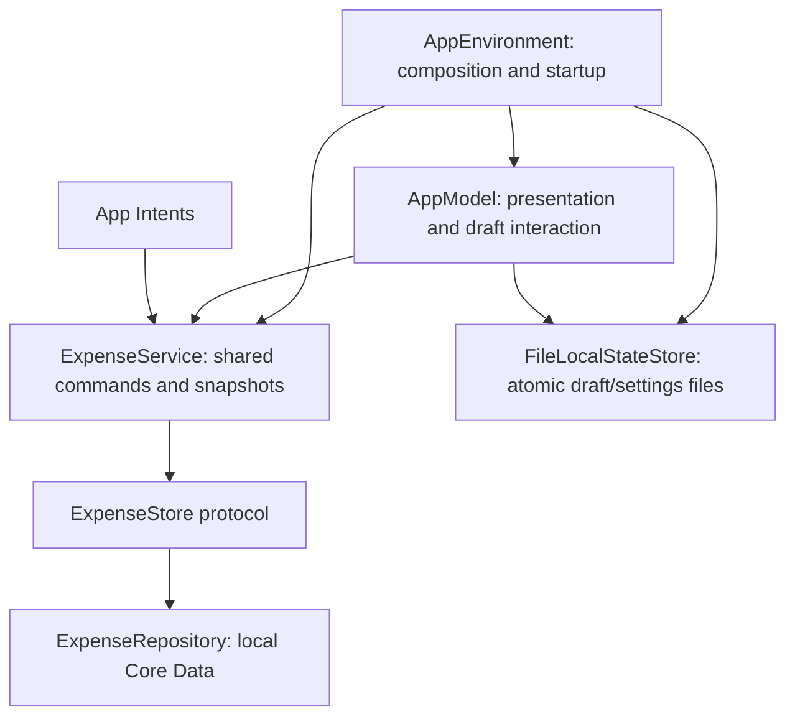

# monocle — architecture direction

Updated: 2026-09-08. Local foundation implemented; future capabilities are identified below.

## Structure

Use SwiftUI for the iPhone interface. Keep screen state and presentation logic with each feature; keep financial calculations and validation in plain Swift independently testable types. Introduce focused repositories/services for persistence, importing, scheduling, backup, and authentication. Prefer one app target and a small reusable core over many speculative packages.

Intended source organisation: App, Features (Recents, Entry, Budgets, Bills, Settings), Domain, Persistence, Integrations, and DesignSystem. Future Mac UI can reuse the domain and data code without reusing the iPhone navigation.

Both views and App Intents call the same expense commands. Confine managed objects to their Core Data contexts; pass stable IDs and value snapshots across boundaries. Serialize writes requiring validation and idempotency; explicit save failures propagate to the caller. Do not report success on an uncommitted in-memory change.

## Implemented dependency boundaries

- `AppEnvironment` is the single production composition root. It selects the existing storage directory, loads local files, opens the repository, seeds the sample book when needed, and constructs dependencies. Startup failure produces a blocked screen without overwriting malformed draft/settings files.
- `ExpenseService` owns observable value snapshots and save/delete/text commands. Both UI and background text intents use this same instance. It publishes only after a successful store write, without a second fallible fetch after commit. Reload publishes a complete snapshot or leaves the previous snapshot intact.
- `ExpenseStore` is an injectable value-only persistence boundary. `ExpenseRepository` confines managed objects to its main-actor context, validates writes, and rolls back failed changes. Main-actor commands have no suspension points; this provides local serialization, not cross-process/cloud coordination.
- `FileLocalStateStore` retains the original JSON filenames and encoding. Missing files use defaults; malformed files throw. `LocalStateStore` permits write-failure tests independently of Core Data.
- `AppModel` owns navigation, the editable draft, settings presentation, and user feedback. It no longer opens databases, selects filesystem paths, seeds records, or encodes files. It is explicitly constructible with test dependencies.
- `SampleBookSeeder` is isolated from normal expense commands. Stable IDs preserve already-created sample records if first-run setup was interrupted. The existing marker prevents reseeding an emptied sample book.

Keep this as one target for now. A future Mac target can share the Application, Domain, and Persistence sources; it will supply its own navigation. Extract a package only when an actual second consumer makes that useful.

## Category and presentation refinements

Category commands use the same ExpenseService/ExpenseStore boundary as expenses. Validation runs both in the service and in the Core Data adapter: trimmed nonempty names (maximum 40 characters), case/diacritic-insensitive duplicate rejection and curated SF Symbols. Stable IDs retain expense references during rename. Deletion checks persisted allocations; presentation additionally protects the active draft and Undo. No schema change is required for create/rename/delete. Archive requires a versioned model change in a later checkpoint.

Number display and strict text parsing use the current system locale, while IDR currency and exact minor-unit storage stay fixed. Fractional entry policy has not expanded. Locale tests explicitly cover US and Indonesian separators.

BottomNavigation supplies two separate glass surfaces while each TabView child hides the native tab bar. This preserves tab view state without overlapping navigation surfaces. Glass uses public SwiftUI APIs; spacing keeps the dark add circle separate from the destination capsule. [Apple custom glass documentation](https://developer.apple.com/documentation/SwiftUI/Applying-Liquid-Glass-to-custom-views)

## Remaining foundation work

Backup/restore is implemented for current durable state, with candidate validation, a safety document and a rollback journal spanning database and local files. See [format and recovery protocol](backup-format.md). Phone export/import/update validation remains required before real-data use. App lock, category archiving/rules, split editing, structured Shortcut parameters, and a real-book onboarding path remain next in the reliable-capture milestone. Budget/bill persistence and sync are later milestones.

The current repository still exposes one fixed sample book. The conceptual multi-book model below is a future design, not implemented multi-book or CloudKit support. Small local saves currently run on the main actor; imports and backup operations will need bounded work/background contexts as their implementation requires. Do not infer finished performance, app locking, or backup safety from this refactor.

## Storage and CloudKit path

Start with a local Core Data SQLite store. Introduce cloud mirroring only at the sync milestone. Core Data's documented CloudKit integration supports same-user device sync and sharing with other iCloud users, including separate private and shared stores. This is the reason for choosing it for monocle. [Apple sample](https://developer.apple.com/documentation/coredata/sharing-core-data-objects-between-icloud-users)

Design the model to satisfy CloudKit restrictions: optional relationships with inverses, no Deny deletion rule, and no reliance on unique constraints. Enforce application invariants at the domain/write boundary. Synchronized relationships can arrive separately; future sync must handle incomplete graphs without reporting incorrect totals. [Apple model requirements](https://developer.apple.com/documentation/coredata/creating-a-core-data-model-for-cloudkit)

Book data must stay within its sharing boundary. Categories, budgets, bill rules, and expenses belong to a book; avoid relationships to globally shared category records. Sharing is future work and is not a switch that can simply be turned on without tests.

An active Apple Developer Program membership is needed for the CloudKit container used by Apple's sharing sample. The first local build does not depend on cloud entitlements. [Apple CloudKit sharing sample](https://github.com/apple/sample-cloudkit-sharing)

## Initial domain model

| Type | Responsibility |
| --- | --- |
| Book | Stable UUID, name, reporting calendar/timezone, currency; one visible book initially |
| Expense | Stable UUID, book, exact total, transaction calendar date, optional note, origin, creation/update timestamps |
| Allocation | Expense, category, exact allocated amount; one or more per expense |
| Category | Book-local stable UUID, label, display metadata, archive status |
| Budget configuration/version | Book, effective period boundary, overall/category limits, start-day configuration |
| Budget period | Explicit start/end dates and applicable limits; historical periods retained |
| Bill rule | Book, recurrence, amount/allocations, independent reminder setting and recording mode |
| Bill occurrence | Rule plus scheduled occurrence identity; pending/recorded/skipped state and optional resulting expense |
| Parsing rule | Book-local keyword-to-category mapping |
| Draft | Durable unfinished entry and input mode, separate from recorded expenses |

This is a conceptual model; exact managed-object fields are established in the persistence milestone. Do not add speculative repayment/account/subscription entities now. Reserve stable book identifiers and origin metadata without creating a fake cloud identity for local users.

## Invariants

- Represent money as checked Int64 scaled units plus a currency code and defined scale. Proposed IDR storage scale is two decimal places; default UI displays whole rupiah. Parse with decimal-safe conversion and reject unsupported precision/overflow instead of silently rounding. Import policy for fractional rupiah remains explicit implementation work.
- A valid recorded expense has a positive total and valid allocations in the same book. Allocations sum exactly to the total; each ordinary expense has one allocation.
- All entry paths run the same validators. Future refunds require an explicit policy; do not implement them as unexplained negative expenses.
- Budget totals count the expense once overall and allocations once in their categories; pending bill occurrences are excluded.
- Transaction reporting dates are calendar dates, distinct from audit timestamps. Periods use inclusive starts and exclusive ends. Preserve reporting dates when timezone changes.
- Persist one scheduled occurrence identity per rule/date and serialize local materialization. Preserve handled/skipped markers to prevent recreation. Multi-device convergence is a separate future test obligation; local serialization does not solve cloud duplication.
- User-entered identical purchases may be legitimate. CSV fingerprints only flag suspected duplicates; do not silently collapse entries.

## Backup and migrations

Use a versioned portable document, proposed as a JSON-based .monoclebackup file. Preserve IDs and references, not Core Data object URIs. Include format version, export time, currency precision, and validation metadata. It is a manual backup, not an encrypted vault or sync mechanism.

Parse and validate into a separate candidate store; verify references, allocation totals, object counts, periods, and occurrence state. Reject corrupted/unsupported backups before mutating the active store. Initially restore by replacement with user-visible scope, safety backup, and recoverable store replacement. Reconcile notifications and refresh UI after successful restoration.

Version the Core Data model from the first persistent release. Use supported migration paths; test old-store fixtures before upgrades. Never recover a migration failure by deleting the user's store. Keep backup schema versioning separate from store schema versioning.

## Integration boundaries

- App Intents: both current shortcuts always require system device authentication. The background text command never unlocks the app UI; the foreground quick-entry command may still arrive at the app lock.
- LocalAuthentication: optional app lock uses `deviceOwnerAuthentication`, so Face ID falls back to the device passcode. Its setting is stored with local settings/backup but credentials are never stored. A privacy shield covers the app switcher immediately; immediate/1-minute/5-minute applies to the next foreground unlock. No monocle password backend.
- UserNotifications: reminders are optional and independent of persisted spending. Background execution is opportunistic; reconcile occurrences on app execution.
- CSV: staged parsing/mapping/validation/review followed by a controlled commit and summary.
- Design system: centralise colours, type, spacing, motion, haptics, and accessibility adaptations.

## Verification emphasis

Test exact arithmetic and splits, period boundaries including leap years, migration preservation, full backup restoration, scheduled retries and duplicate prevention, and simultaneous entry attempts. Validate parsing ambiguity and import errors with realistic examples. Test UI primarily through the user's capture flow and accessibility behaviours. Avoid arbitrary coverage targets or tests that just restate view implementation.
