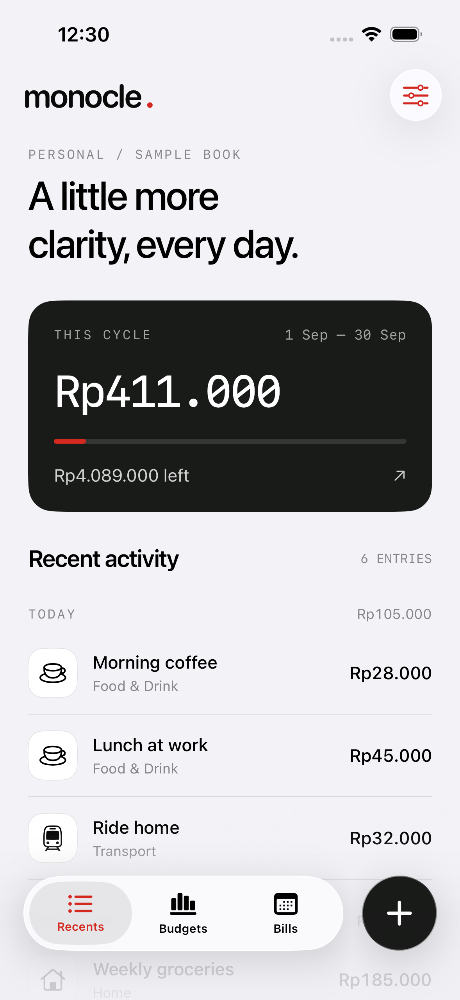
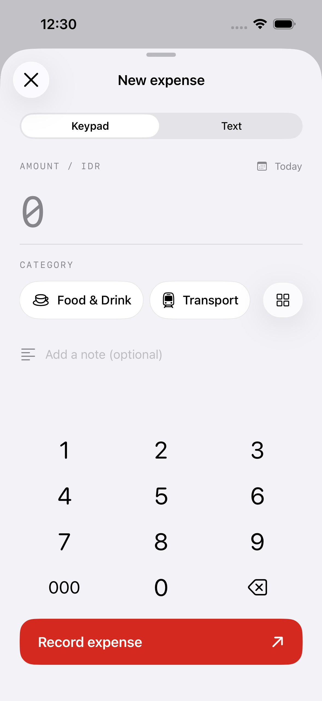
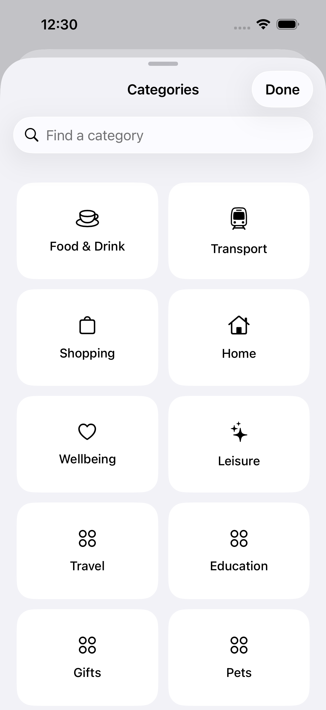
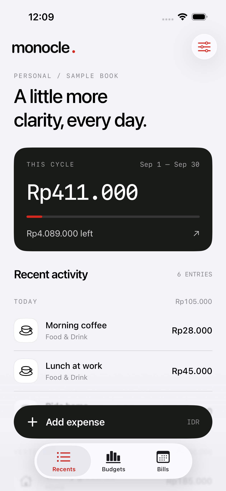
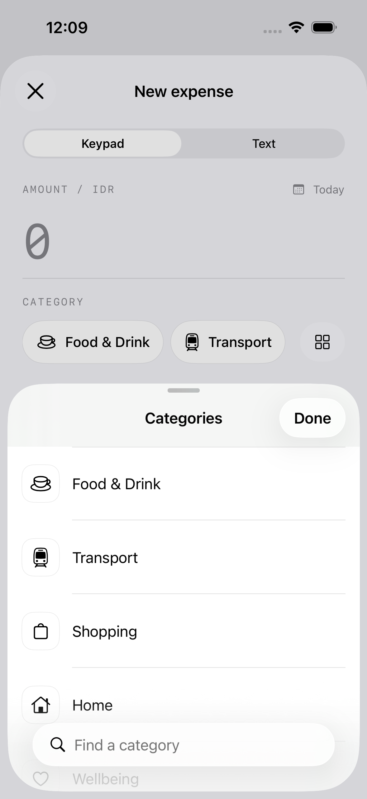
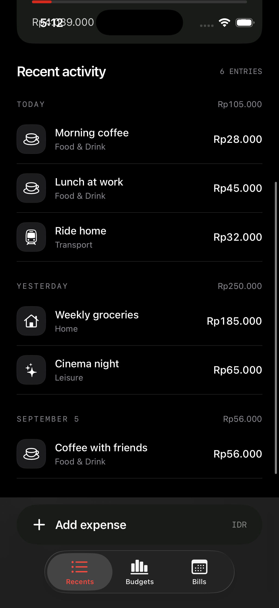
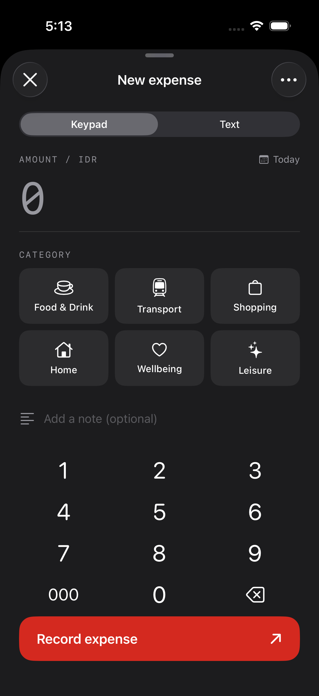
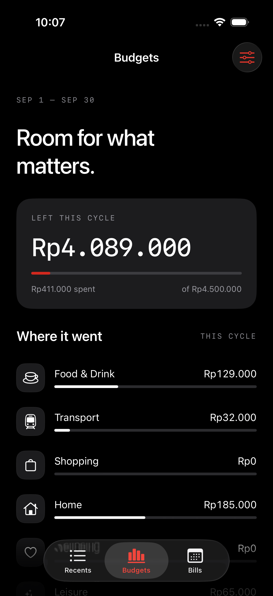
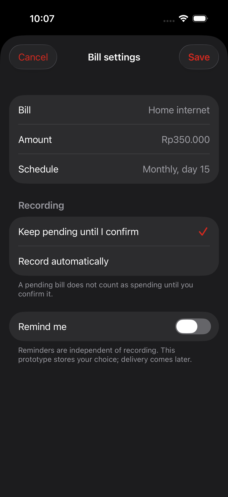
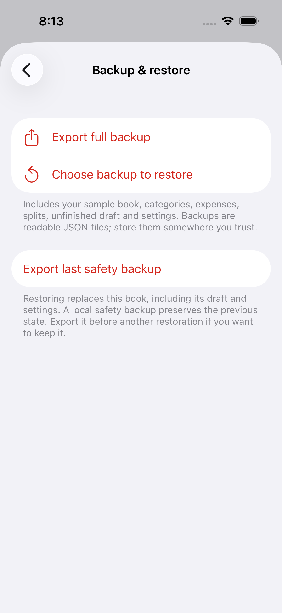

# monocle — prototype 0.1.3, build 13

Updated: 2026-09-09

## What you can try

- Recents with an actual spending total, date groups, and category labels.
- Add Expense with a custom keypad and one shared draft across keypad/text modes.
- Type `Coffee 28k`: amount and category update as you type. Review and Record.
- Edit an entry by tapping it; touch and hold to repeat or delete. Undo restores the last deleted entry.
- Interrupt the app with an unfinished draft, then reopen and continue. Explicit Close or swipe-down asks Discard/Keep editing; discarding frees entry for another transaction.
- Browse a compact horizontal category row without tap-triggered recentering, or open All categories for a searchable grid.
- In Settings → Categories, create a category, rename it or choose an icon. Swipe to delete unused categories; saved references, draft and Undo are protected.
- Amount separators follow the system locale, including text input. Currency remains IDR; entry still uses whole rupiah.
- Home uses a small native Settings control, a three-destination glass capsule, and a separate dark glass + circle on the same bottom row. The keypad adapts to available height; press/amount animations and haptics provide brief feedback.
- Review the persisted overall/category budget and effective-date history. Change the amount for the current or next cycle, or move the start day at the next boundary.
- Choose automatic or pending recording for the sample bill, with an independent reminder preference.

Budget settings now use persisted effective-dated versions and real cycle boundaries, including the explicit transition period created by a start-day change. Bills remain an interaction preview; scheduling and notifications are inactive.

- Settings → Backup & restore exports a portable `.monoclebackup` file, validates an imported file for review, and replaces the book only after confirmation and a safety backup. Export last safety backup preserves the previous state outside the app.

## Data and foundation

Records use a versioned Core Data model, with book, category, expense, allocation, and budget-version entities. Amounts use exact integer minor units. UI and the text Shortcut call the same validated save operation. The persistence layer can store and validate splits, but the split editor is deferred to the next milestone.

Sample records are created once with stable identifiers. Clearing a book does not reseed it. Settings offers an explicit "Start your real book" flow: it keeps categories/settings, clears sample entries and the unfinished draft, and creates a safety backup before assigning a new real-book identity. Edits and retries retain the transaction ID. Draft and book-setting files are saved atomically. Automated UI tests use distinct stores.

App locking, category archiving/rule editing, bill rules/occurrences, CSV import/export, and sync remain unimplemented. Backup/restore and production budget history are implemented locally; signed-phone export/import/update checks remain pending. No sync/cloud entitlements are enabled. Use test purchases in this version.

## Current Shortcuts

- **Open Quick Entry**: opens the shared draft.
- **Add Expense from Text**: validates and records a recognized expense in the sample book, without a confirmation screen.

The intent declares local-device authentication. Actual locked/unlocked behaviour and discovery in Shortcuts must be validated in the SideStore-signed installation. Structured Add Expense parameters are a later capture-milestone addition.

## Validation evidence

The simulator build and Release arm64 iPhone build succeeded. The device package is unsigned and must be re-signed by SideStore. The compiled bundle identity is `com.farchan.monocle`; keep this stable, and record any identity changes made during SideStore signing.

Six domain/storage tests pass: exact parsing/rejections, ambiguous text categories, split/date validation, month-end and leap-year boundaries, disk-store reopen/upsert/invalid-save preservation, and draft encoding.

Six foundation tests cover shared text commands, identity-preserving retries, failed writes/discard/settings, post-commit publication without a second read, old JSON encoding, and corrupt-file preservation. The previous foundation baseline passed 20 tests. Result: `build/FoundationTests-20260908.xcresult`.

Current validation adds locale correctness, category name/icon validation, rename/history protection, and an end-to-end custom-category/relaunch/no-scroll-jump UI check. The 0.1.2 baseline passed 24 tests (15 unit/storage and 9 UI) on the iPhone 15 Pro simulator. Result: `build/Refinement012FinalTests.xcresult`. The Release arm64 build succeeds without compiler warnings. Current light screenshots were inspected. The first navigation run exposed an overlapping native tab bar; visibility is now set in each tab and regression-tested.

The previous 0.1.1 UI pass validated eight flows on the iPhone 15 Pro simulator: interruption recovery, text interpretation/mode switching, invalid save, budget/bill preferences, keypad layout with 18 categories, Close/Keep editing/Discard, swipe discard, and replacing a recovered draft to edit another transaction. Results: `build/Final011Tests.xcresult`. The larger-text keypad/category test also passed in `build/LargeType011Tests.xcresult`. The final Home accessibility label fix compiles and is covered by the current normal-size suite; a further large-type visual check remains.

The user reports working functions and snappy navigation on their SideStore-installed iPhone 15 Pro. Real-device haptic feel, signed Shortcut behaviour, refresh, and update preservation still require phone checks. VoiceOver and Reduce Motion have not received a complete manual audit.

The foundation now separates dependency assembly, shared expense commands, Core Data, atomic local files, and presentation state. The compiled bundle identity, storage folder, and draft/settings encoding remain unchanged; the Core Data model now has a V2 budget migration. See [roadmap and Terra continuation instructions](../planning/roadmap.md) and [architecture](../planning/architecture.md) for implemented boundaries and remaining work.

## Previous screens (0.1.2)

## Previous screens (0.1.1)

## Earlier visual baseline (0.1.0)

## Device package

Latest delivered package: `/Users/farchan/Library/Mobile Documents/com~apple~CloudDocs/Monocle-codex/monocle-0.1.3-build-13-unsigned.ipa` (preserved outside Git). Release build 13, arm64, iPhone only, minimum iOS 26.0. Unsigned; SideStore must sign it. Package integrity, version, device family and bundle identity verified. Earlier build artifacts are preserved.

SHA-256: `c8940a35459cfa5619b6ee5eb2bbdf0a37ed589d6ae532a0f54304308fb21741`.

## iPhone / SideStore checkpoint

1. Transfer the supplied unsigned IPA to the iPhone and import it through SideStore. Let SideStore sign it with the existing account/setup.
2. Open monocle and record a test coffee through each entry mode. Assess thumb reach, keyboard feel, readability, and haptics.
3. Try Open Quick Entry and Add Expense from Text in Shortcuts. Test `Coffee 28k`, an unknown category, and locked/unlocked invocation.
4. Refresh the installation through SideStore and verify records and the draft remain.
5. On the next build, install over this one without uninstalling and compare the same records and Shortcut behaviour.

The user confirmed the original installation works on iPhone 15 Pro. The updated build has not yet been verified on that phone. Install over the existing app using the same SideStore setup; do not uninstall to update. Credentials and provisioning profiles are not part of the repository.

## Next implementation checkpoint

Collect feedback on the native flow. Then complete phone backup/restore/update verification and remaining reliable capture: app lock, category archiving/rules, split UI and structured Shortcut parameters. Only mark daily use ready when those checks and the user's phone review pass. Budget history, real bills, and CSV follow the agreed implementation plan; they remain in v1 scope.

## Backup milestone (0.1.3)

Implementation and recovery contract: [backup format](../planning/backup-format.md). Tests exercise full values/IDs/splits/draft/settings, candidate rejection before mutation, rollback at every activation stage, failed safety backup creation, disk reopen recovery, corrupt journal retention and empty-book seed prevention. The UI test presents the system Files export picker; its initial Cancel-label assumption was corrected to assert the visible Save action.

All 33 tests pass (23 unit/storage and 10 UI); Release arm64 build succeeds without compiler warnings.

Final evidence: `build/Backup013FinalTests.xcresult`, `/tmp/monocle-013-final-tests.log`; device log `/tmp/monocle-013-device.log`. The repository/store model now includes the V2 budget migration; app identity remains unchanged. Actual file saving/import and replace/cancel flows still need a signed iPhone review.

## M3 budget slice evidence — 2026-09-09

The app and XCTest sources type-check under Swift 6. A macOS Core Data smoke run persisted and upserted budget history, then migrated a V1 store while preserving its expense and seeding the initial budget. Simulator build/test execution remains pending because the current host has no available CoreSimulator runtime/service.
